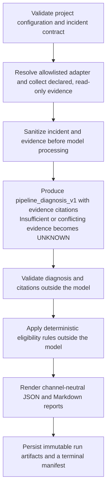
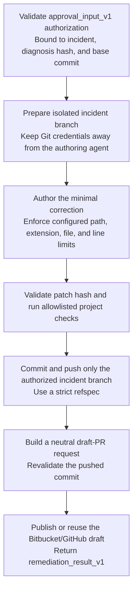

# Pipeline Guard

Evidence-grounded diagnosis and policy-gated remediation for failed data pipelines, available
interactively in Claude Code and through selectable unattended model backends.

Pipeline Guard validates a normalized incident, collects traceable evidence,
asks a tool-free diagnosis agent to classify the failure, validates every
citation, and applies a deterministic eligibility policy. For an eligible and
verifiably authorized code failure, it prepares an isolated workspace, validates
the patch, commits and pushes the incident branch, and publishes a draft pull
request through a deterministic, draft PR publishing boundary.

> **Current scope:** diagnosis does not modify the repository or rerun the failed
> pipeline. Remediation requires verified authorization bound to the incident,
> diagnosis, and base commit; edits only configured paths in an isolated workspace;
> runs only project-declared validation commands; and can commit and push only a
> repair branch to create or reuse a draft pull request. Pipeline Guard has no
> built-in operation to approve or merge pull requests, deploy changes, or rerun the
> failed pipeline. Project-declared validation commands must not perform those
> operations and must use an isolated, non-production target when they can modify
> external systems.

> **Validated automation status:** the Databricks Jobs sandbox has exercised the
> complete unattended remediation path: failure collection, diagnosis, policy
> authorization, bounded authoring, project validation, restricted branch push,
> and automatic draft-PR publication. A person still reviewed and merged that
> draft before a healthy pipeline rerun. Bitbucket Pipelines has validated the
> report-only and recursion-guard boundaries, but not host-side remediation;
> Airflow validation remains pending.

## Table of Contents

- [Overview](#overview)
- [Agents](#agents)
- [Skills](#skills)
- [Supported Adapters](#supported-adapters)
- [Prerequisites](#prerequisites)
- [Installation](#installation)
- [Quick Start](#quick-start)
- [Project Configuration](#project-configuration)
- [Incident Input](#incident-input)
- [Results and Artifacts](#results-and-artifacts)
- [Remediation and Draft PRs](#remediation-and-draft-prs)
- [Unattended Execution](#unattended-execution)
- [Runtime Compatibility](#runtime-compatibility)
- [Security and Redaction](#security-and-redaction)
- [Architecture](#architecture)
- [Components Reference](#components-reference)
- [Validation](#validation)
- [Current Limitations](#current-limitations)

## Overview

Pipeline Guard separates model reasoning from deterministic validation,
authorization, and side effects.

The diagnosis flow:



For an eligible `CODE` failure, the authorized remediation flow continues with:



The `diagnose` skill supports interactive use, while `diagnose_cli.py` provides
the canonical headless entrypoint. The deterministic publication boundary can
also be invoked directly by an orchestrator.

## Agents

| Agent | Role | Tools |
|---|---|---|
| `diagnosis-agent` | Produces a structured diagnosis using only the validated incident and collected evidence | None |
| `remediation-agent` | Authors the smallest authorized code correction inside the isolated workspace | Restricted read, write, and edit file tools controlled by the remediation flow |

The diagnosis agent cannot read files, run commands, access a network service,
or change the consumer project. The remediation agent receives only the
validated context required to author the authorized fix. It cannot access Git or
provider credentials, publish a PR, merge, or deploy. Adapter-specific details
stay isolated under `adapter_details.<adapter-name>`.

## Skills

| Skill | Use it when | Result |
|---|---|---|
| `pipeline-guard-setup` | Installing or configuring the plugin in a consumer project | Materializes and validates `config/pipeline-guard.yaml` from the `generic` or `dbt` preset |
| `diagnose` | Investigating or explaining a failed pipeline or dbt run | Runs the complete read-only flow and returns a validated diagnosis, eligibility decision, limitations, and neutral report |
| `remediate` | Applying an authorized correction for an eligible incident | Verifies authorization, prepares the workspace, validates and pushes the patch, and orchestrates draft publication |
| `publish-draft-pr` | Publishing or reusing the draft after the incident branch is pushed | Revalidates the remote commit and tests, then creates or reuses a Bitbucket or GitHub draft PR |

Skills are selected from user intent. You can ask naturally, for example:

```text
Set up Pipeline Guard for this dbt project.
```

```text
Diagnose the pipeline incident described in ./incidents/failed-run.json.
```

```text
Apply the approved Pipeline Guard correction for incident INC-PIPELINE-001.
```

```text
Publish or reuse the validated draft PR for this Pipeline Guard run.
```

Provide only a safe incident file path in an interactive diagnosis request.
Do not paste logs, credentials, or the incident JSON into the prompt.

## Supported Adapters

| Adapter | Purpose | Evidence source |
|---|---|---|
| `mock` | Dependency-free setup and integration validation | Normalized incident fields |
| `dbt` | Diagnose failed dbt models and tests | Incident-declared `target/run_results.json` and `target/manifest.json` whose SHA-256 hashes match |

Both adapters implement the same
[`pipeline_adapter_interface`](contracts/schema/pipeline_adapter_interface.schema.json).
The closed adapter registry rejects unregistered names.

## Prerequisites

- Claude Code 2.1.295 or later for interactive plugin use and for the unattended
  `anthropic` authoring backend. OpenAI-compatible unattended backends do not
  launch Claude Code.
- `uv` must be installed and available on `PATH`.
- Git must be installed and available on `PATH` for workspace, commit, and push operations.
- A writable `CLAUDE_PLUGIN_DATA` directory. Claude Code provides this to an
  installed plugin; set it explicitly when invoking the headless CLI manually.
- A configured model backend. The provider profile defaults to Anthropic, but
  its model and credentials must still be configured. Unattended runs
  may instead select `databricks`, `openai`, `gemini`, `ollama`, or a custom
  `openai-compatible` Chat Completions endpoint through `runtime.model` or
  `--model-provider`.
- The selected model identifier and credential supplied through configuration
  references or environment. Ollama may run without an API key.
- Remediation requires verified authorization, an HTTPS repository URL, allowlisted
  validation commands, and a credential reference in the project configuration.
- Draft publication supports Bitbucket Cloud and GitHub. Provider credentials
  must be supplied through environment variables, never through the project
  configuration or publication payload.

Verify the local runtime:

```bash
uv --version
git --version
claude --version # required only for interactive use or the anthropic authoring backend
```

Never store a literal credential in `config/pipeline-guard.yaml`, an incident
file, or an evidence artifact.

## Installation

For a local checkout, start Claude Code with the Pipeline Guard plugin directory:

```text
claude --plugin-dir .
```

For a published install, add its marketplace and install Pipeline Guard:

```text
/plugin install pipeline-guard@<marketplace-name>
```

## Quick Start

### 1. Materialize the project configuration

Ask Claude Code to set up Pipeline Guard and choose one preset:

- `generic` uses the dependency-free `mock` adapter.
- `dbt` uses the `dbt` adapter for a project containing
  `dbt_project.yml`.

The setup skill writes:

```text
<consumer-project>/config/pipeline-guard.yaml
```

It changes only the copied consumer configuration and validates it before
reporting success. If the file already exists, setup requires explicit
confirmation and preserves the original as `pipeline-guard.yaml.bak`.

You can also validate a materialized configuration directly:

```bash
uv run /path/to/pipeline-guard/scripts/validate_config.py \
  ./config/pipeline-guard.yaml
```

### 2. Prepare a normalized incident

Save a UTF-8 JSON document that conforms to
[`incident_input_v1`](contracts/schema/incident_input_v1.schema.json). The
example below is sufficient for the `generic` preset:

```json
{
  "schema_version": "1.0",
  "incident_id": "INC-PIPELINE-001",
  "source": "ci",
  "environment": "test",
  "pipeline_id": "daily-build",
  "run_id": "run-001",
  "failed_step": "compile",
  "occurred_at": "2026-10-15T12:00:00Z",
  "error_summary": "The compilation step failed.",
  "artifacts": [],
  "project_profile": "generic"
}
```

An incident may use `null` for an unavailable field only when
`unavailable_fields` contains a non-empty reason for that same field.
`incident_id` must be an opaque identifier without PII or secret-shaped
values.

### 3. Run a diagnosis

For interactive use, ask Claude Code to diagnose the incident and provide the
incident path. The `diagnose` skill delegates the entire operation to the
canonical headless entrypoint.

For non-interactive use:

```bash
uv run /path/to/pipeline-guard/scripts/diagnose_cli.py \
  --config ./config/pipeline-guard.yaml \
  --project-root . \
  ./incidents/failed-run.json
```

Omit the final file argument to read the same JSON contract from standard input.
Use `--model-provider` and `--model` to override `runtime.model` or the
provider-specific environment variables.

### 4. Interpret the exit code

| Exit code | Meaning |
|---|---|
| `0` | A validated, evidence-backed diagnosis completed |
| `1` | An operational failure occurred |
| `2` | The incident or project configuration is invalid |
| `3` | The flow stopped safely with an `UNKNOWN` cause because evidence was insufficient or a limit was reached |

Exit code `3` is a controlled result, not an invitation to infer a missing
cause.

### 5. Remediate an interactively approved incident

In the interactive skill flow, remediation is available only after diagnosis returns
`ELIGIBLE_FOR_REMEDIATION` and a human approval is recorded in an
`approval_input_v1` bound to the same incident, diagnosis hash, and base commit.

Invoke the `remediate` skill and provide safe paths to the validated diagnosis,
eligibility decision, approval, and project configuration. The skill performs
the following operations in order:

1. validates approval and repository configuration;
2. creates or reuses an isolated incident workspace;
3. authors and validates the minimal patch;
4. runs all configured validation commands;
5. commits and pushes only the incident branch;
6. builds a neutral draft-PR request;
7. revalidates the remote branch and publishes or reuses the draft PR.

Do not ask the skill to bypass approval, edit the primary checkout, skip patch
validation, force-push, merge, deploy, or expose credentials.

### 6. Run the publication boundary non-interactively

An orchestrator may execute the final deterministic publication stage directly
after the authorized incident branch is pushed. The input JSON contains only the
neutral request, incident identity, run identity, and isolated workspace path:

```json
{
  "request": {
    "title": "fix(pipeline): remediate INC-PIPELINE-001",
    "body": "## Incident\n\nID: INC-PIPELINE-001\nRun: run-001\n",
    "branch": "pipeline-guard/INC-PIPELINE-001",
    "base": "main",
    "draft": true
  },
  "incident_id": "INC-PIPELINE-001",
  "run_id": "run-001",
  "workspace_path": "/absolute/path/to/isolated/workspace"
}
```

Execute the boundary through standard input:

```bash
uv run /path/to/pipeline-guard/scripts/pr_publication.py \
  --config ./config/pipeline-guard.yaml \
  < ./publication-request.json
```

The script accepts UTF-8 JSON with or without a byte-order mark. It verifies the
remote incident commit, requires a clean matching workspace, re-runs the
allowlisted validation commands, applies the deterministic publication policy,
and only then invokes the private draft publisher. It returns `BLOCKED`,
`VALIDATED`, or `PUBLISHED_UNVALIDATED` together with the authoritative test
result and, when published, the draft PR `id` and `url`.

## Project Configuration

The bundled presets are:

- [`generic.yaml`](config/presets/generic.yaml)
- [`dbt.yaml`](config/presets/dbt.yaml)

Both conform to
[`project-config.schema.json`](config/schema/project-config.schema.json).

| Section | Purpose |
|---|---|
| `project` | Identifies the consumer project |
| `pipeline` | Selects the registered adapter and pipeline root |
| `repository` | Selects Bitbucket or GitHub, repository URL, default branch, incident-branch prefix, push credential reference, and allowed Git operations |
| `evidence_providers` | Declares provider configuration; headless diagnosis currently requires this list to remain empty |
| `validation` | Declares the allowlisted commands executed before commit and repeated before publication |
| `safety` | Defines editable paths and extensions, sensitive paths, and file/line limits enforced during remediation |
| `remediation` | Controls whether failed or incomplete validation may still produce a clearly marked unvalidated draft |
| `unattended` | Controls non-interactive remediation opt-in, service identity, policy authorization, draft target, and run limits |
| `eligibility` | Configures the deterministic post-diagnosis policy |
| `runtime.execution_budget` | Limits tool calls, elapsed seconds, and total model tokens |
| `runtime.artifact_store` | Selects artifact storage; the headless diagnosis CLI currently requires `local` |

Configuration validation rejects:

- unknown fields or unregistered adapters;
- malformed provider configuration;
- literal credentials where an environment-variable or secret reference is
  required;
- repository URLs containing embedded user information;
- invalid or incomplete execution budgets.

## Incident Input

`incident_input_v1` is independent of Airflow, CI, Slack, or any other
orchestrator. Required fields describe the source, environment, pipeline, run,
failed step, occurrence time, safe error summary, and project profile.

Large artifacts are references, not embedded payloads:

```json
{
  "type": "dbt_run_results",
  "uri": "artifact://dbt/run_results.json",
  "hash": "sha256:<64-hex-character-digest>"
}
```

For the dbt adapter:

- place `run_results.json` and `manifest.json` under
  `<project-root>/<pipeline.root>/target/`;
- declare each available artifact in the incident using
  `dbt_run_results` or `dbt_manifest`;
- provide the exact SHA-256 digest;
- expect a safe failure when a declared file is missing, malformed, or has a
  different hash.

## Results and Artifacts

For exit codes `0` and `3`, standard output is one canonical JSON result
containing:

- `diagnosis` — the validated `pipeline_diagnosis_v1`;
- `eligibility_decision` — deterministic decision, rule, policy version, and
  reasons;
- `report` — channel-neutral machine-readable report;
- `report_markdown` — human-readable rendering;
- `evidences` — sanitized evidence records used by the diagnosis;
- `exit_code` — the authoritative process result.

With the local artifact store, each terminal run is kept under:

```text
${CLAUDE_PLUGIN_DATA}/runs/<internal-run-id>/
```

The logical artifacts are:

| Reference | Content |
|---|---|
| `result.json` | Complete canonical result |
| `diagnosis.json` | Validated diagnosis |
| `eligibility.json` | Deterministic eligibility decision |
| `report.json` | Neutral JSON report |
| `report.md` | Neutral Markdown report |
| `manifest.json` | Terminal status, contract versions, evidence hashes, timestamps, duration, and limitations |

Artifact references are stored as SHA-256 file names, so the physical names in
the run directory differ from the logical names above. Repeating the same
incident and execution context reuses the immutable terminal result instead of
creating a conflicting duplicate.

## Remediation and Draft PRs

Pipeline Guard accepts only a validated, eligible, and verifiably authorized
remediation. The authorization is checked outside the model and is bound to:

- `incident_id`;
- the canonical diagnosis hash;
- the exact repository base commit;
- the authorizing actor and positive authorization lifetime.

The remediation model has only bounded file tools and cannot access a warehouse.
Project-declared validation commands run separately and are executed as written;
Pipeline Guard verifies that they were declared and records their results, but does
not infer their external side effects. Commands such as `dbt build` must therefore
use an isolated, non-production target with least-privilege credentials. Validation
commands must not approve or merge pull requests, deploy to production, or rerun the
failed host pipeline.

The terminal result conforms to
[`remediation_result_v1`](contracts/schema/remediation_result_v1.schema.json).
A successful publication has `status: DRAFT_PR_PUBLISHED` and includes:

- the authorized base commit and pushed incident commit;
- changed files and line counts derived from Git;
- the canonical SHA-256 patch hash;
- the authoritative publication-time test results;
- `pr_validation_status` as `VALIDATED` or `PUBLISHED_UNVALIDATED`;
- the hosted draft PR `id` and `url`.

### Git and credential boundary

The repository configuration must allow only `push_incident_branch`. The Git
executor pushes the strict refspec for the configured incident branch and does
not expose merge, force-push, tag, branch-administration, or deployment
operations.

Provider credentials are resolved only from environment references:

| Provider | Required | Optional verification or authentication mode |
|---|---|---|
| Bitbucket Cloud | `BITBUCKET_API_TOKEN` | `BITBUCKET_URL`, `BITBUCKET_EMAIL` |
| GitHub | `GITHUB_API_TOKEN` | `GITHUB_URL` |

The plugin never places those values in JSON payloads, command arguments,
prompts, PR content, logs, or result contracts.

### Standalone publication boundary

Pipeline Guard does not require the Git hosting plugin at installation or
runtime. Its private publisher implements only the Bitbucket and GitHub
operations needed to locate, create, reuse, or safely close the draft PR
produced by this remediation flow. It is not a general pull-request management
API.

Draft identity is deterministic. Reuse always requires all of the following to
match:

- provider repository owner and repository name;
- source repository, not only the source branch name;
- source branch and destination branch;
- open draft state.

Interactive publication additionally matches the visible `ID:` and `Run:` rows.
Unattended publication matches the stable visible `Signature:` row derived from
repository, pipeline, failed commit, and target branch; its `ID:` and `Run:` rows
remain trace metadata and may differ on a later host retry.

A retry with the same identity returns the existing draft. In the interactive
flow, a matching open non-draft blocks duplicate publication. The stronger
unattended identity ignores non-drafts and only reuses an open draft with the
complete signature. If a provider ignores `draft=true`, the publisher attempts
to close the unsafe PR and fails explicitly.

## Unattended Execution

Unattended execution runs the complete repair flow in isolated automation
environments. It extends the existing diagnosis, remediation, and standalone
draft-publication boundaries; it does not introduce a dependency on another
plugin.

The unattended entrypoint:

- expose one host-neutral command with an explicit `--mode unattended`;
- execute without interactive questions or confirmations;
- authorize remediation through versioned project policy and a service identity;
- use an isolated, managed workspace, retaining a clean committed workspace when
  publication must be resumed safely;
- return a versioned machine-readable result, a human summary, and stable exit codes;
- publish or reuse the draft PR through Pipeline Guard's own deterministic boundary;
- support Databricks Jobs, Bitbucket Pipelines, Airflow, and other orchestrators
  without embedding host-specific workflow logic in the plugin.

Start with the [complete unattended guide](docs/unattended/README.md), then
choose the [Databricks](docs/unattended/databricks.md),
[Bitbucket Pipelines](docs/unattended/bitbucket-pipelines.md), or
[Airflow](docs/unattended/airflow.md) host guide. The implementation is
host-neutral, but the host-specific sandbox validations remain mandatory before
production adoption; each guide states its current validation status.

```bash
uv run /path/to/pipeline-guard/scripts/unattended_cli.py \
  --mode unattended \
  --config ./config/pipeline-guard.yaml \
  --project-root . \
  --output-dir /retained/pipeline-guard/output \
  --authorization-state-dir /retained/pipeline-guard/authorization-state \
  ./incident.json
```

The provider profile defaults to Anthropic/Claude Code; the model, endpoint, and
credentials must still satisfy that profile. To use another backend, configure
it without storing a literal credential:

```yaml
runtime:
  model:
    provider: ollama
    name: llama3.3
    base_url: http://127.0.0.1:11434/v1
```

Provider profiles are `anthropic`, `databricks`, `openai`, `gemini`, `ollama`, and
`openai-compatible`. The custom profile requires `base_url`; remediation also
requires that the endpoint implement Chat Completions function tools.

Provider and model selection prefer CLI overrides, then `runtime.model`, then
environment variables. Base URLs and credentials use configured references plus
the applicable generic or provider-specific fallbacks.
See the [unattended model table](docs/unattended/README.md#model-backend) for the
exact variables and defaults.

## Runtime Compatibility

Interactive Pipeline Guard and the unattended `anthropic` authoring backend
require Claude Code 2.1.295 or later. Its diagnosis redaction hooks rely on
`onFailure: "block"` to fail closed when a hook errors or times out; earlier
Claude Code versions do not provide that guarantee. OpenAI-compatible
unattended authoring enforces the same path policy directly and exposes only
bounded read, write, and edit tools; it does not require the Claude executable.

Claude Code does not support `matcher` on `UserPromptSubmit`, and its `if` field
is evaluated only for tool events. Consequently, the prompt-guard process runs
on every submitted prompt while this plugin is enabled, then exits silently for
non-diagnosis prompts. Because the guard is fail-closed, missing `uv`, a process
failure, or the configured 30-second timeout blocks that prompt. This all-prompt
runtime scope is intentional so diagnosis data cannot bypass sanitization before
model processing.

Anthropic-compatible Unity Gateway model services may not expose
`/v1/messages/count_tokens`. The diagnosis runner uses a conservative local
input bound only for the gateway's exact unsupported-route response; all other
token-counting failures remain operational errors. Actual model usage is still
charged against the execution budget before any diagnosis is accepted.

## Security and Redaction

Before diagnosis data reaches the model or persisted artifacts, Pipeline Guard
masks sensitive fields, authentication headers, cookies and session identifiers,
private keys, email addresses, signed URL parameters, Azure Shared Access
Signatures, and known vendor token formats. The vendor patterns include
Atlassian API tokens and DigitalOcean personal, OAuth, and refresh tokens.
Standalone 40-character values that have the mixed-case, base64-like shape of
AWS secret access keys are also masked conservatively.
Recognized sensitive field names and assignment labels cover English and
Portuguese; known token formats and signed credentials are matched independently
of language.

For interactive use, a fail-closed `UserPromptSubmit` hook blocks diagnosis
prompts containing recognized sensitive data before Claude processes them. Pass
only a safe path to the incident JSON instead of pasting incident contents into
the prompt. A blocking hook does not erase text already entered from local
Claude Code prompt history, so raw credentials should never be pasted there.
The scoped `PreToolUse` hooks then sanitize diagnosis-bound tool inputs. Direct
headless execution applies the same sanitizer inside the CLI.

This sanitizer is a defense-in-depth boundary, not a universal secret detector.
Arbitrary unlabeled opaque values without a recognizable format cannot be
classified reliably. Evidence producers must keep credentials in labeled
sensitive fields or secret references and must not place unknown raw secrets in
incident evidence.

Additional safety properties:

- the incident is validated before any evidence is collected;
- the diagnosis agent has no tools;
- every material claim must cite an existing evidence identifier;
- an external validator checks the diagnosis contract and citations;
- eligibility is decided by deterministic code, not by the model;
- execution budgets limit tool calls, elapsed time, and tokens;
- invalid, insufficient, conflicting, or exhausted runs stop safely;
- diagnosis performs no project, Git, warehouse, deployment, or remediation writes;
- remediation writes only inside the isolated workspace, pushes only the authorized incident branch, and
  publishes only a draft PR after deterministic revalidation.

## Architecture

```mermaid
flowchart LR
    U[User or orchestrator] --> I[incident_input_v1]
    I --> IV[Incident and config validation]
    IV --> A[Allowlisted adapter]
    A --> E[Traceable evidence]
    E --> R[Redaction]
    R --> D[Tool-free diagnosis agent]
    D --> V[External diagnosis validation]
    V --> G[Deterministic eligibility gate]
    G --> O[JSON and Markdown diagnosis reports]
    O --> S[Immutable artifacts and run manifest]

    G -->|eligible CODE failure| AP[Verified approval_input_v1]
    AP --> W[Isolated incident workspace]
    W --> RA[Constrained remediation agent]
    RA --> PV[Patch validation and tests]
    PV --> GC[Deterministic commit and push]
    GC --> NR[Neutral draft PR request]
    NR --> RP[Remote commit and test revalidation]
    RP -->|policy approved| PP[Private Bitbucket or GitHub draft publisher]
    PP --> PR[Draft PR id and URL]
    PR --> RR[remediation_result_v1]

    IV -. invalid .-> X[Exit 2]
    D -. insufficient evidence .-> K[UNKNOWN and exit 3]
    K --> V
    AP -. invalid or expired .-> AB[Blocked remediation]
    PV -. path, limit, or test failure .-> AB
    RP -. publication policy blocked .-> AB
```



The flow is host-neutral: the incident may originate from a local command, CI,
or an orchestrator, but the contract and result do not depend on that source.
The publication stage is provider-specific only at the final private adapter
boundary and does not require another plugin.

### Prepared remediation workspaces

Prepared incident workspaces are retained under the `parent_dir` supplied to
`prepare_workspace`; when omitted, the system temporary directory is used.
Before deleting a cache with commits beyond its authorized base,
`discard_prepared_workspace` fetches all branches from the configured `origin`
and refuses to remove commits absent from those branches. Preserve or push those
commits, or pass `confirm_unpushed_commits=True` after reviewing and accepting
the possible loss of local commits. A discard removes the cache, including
committed and uncommitted work.

Branch rebind audit JSON files are written to a sibling `<workspace-cache>.audit`
directory, so discarding the workspace cache keeps those records. The audit
directory remains local to the workspace parent and can still be removed by
cleanup of that parent (including operating system cleanup when the default
temporary directory is used).

## Components Reference

| Path | Responsibility |
|---|---|
| `.claude-plugin/plugin.json` | Registers the plugin, four skills, and two agents |
| `skills/pipeline-guard-setup/SKILL.md` | Materializes and validates consumer configuration |
| `skills/diagnose/SKILL.md` | Routes interactive diagnosis to the canonical entrypoint |
| `skills/remediate/SKILL.md` | Orchestrates the authorized remediation flow |
| `skills/publish-draft-pr/SKILL.md` | Runs the deterministic standalone publication boundary |
| `agents/diagnosis-agent.md` | Tool-free, evidence-grounded diagnosis prompt |
| `agents/remediation-agent.md` | Authors the minimal authorized fix inside the isolated workspace |
| `hooks/hooks.json` | Registers fail-closed prompt and tool-input redaction |
| `hooks/redact.py` | Claude Code hook entrypoint |
| `scripts/diagnose_cli.py` | Canonical headless diagnosis flow used by interactive and automated callers |
| `scripts/model_backend.py` | Resolves Anthropic and OpenAI-compatible model profiles and sanitizes transport failures |
| `scripts/openai_authoring.py` | Runs the bounded file-tool loop for OpenAI-compatible remediation models |
| `scripts/authoring_runner.py` | Dispatches remediation to Claude Code or the direct OpenAI-compatible tool loop |
| `scripts/validate_config.py` | Schema, registry, credential-reference, and semantic configuration validation |
| `scripts/incident_validator.py` | Validates and normalizes `incident_input_v1` |
| `adapters/registry.py` | Closed registry for pipeline adapters |
| `adapters/dbt/adapter.py` | Converts declared dbt artifacts into traceable evidence |
| `scripts/diagnosis_validator.py` | Validates diagnosis structure and citations |
| `scripts/eligibility_gate.py` | Applies deterministic eligibility policy |
| `scripts/report_renderer.py` | Produces neutral JSON and Markdown reports |
| `scripts/artifact_store.py` | Persists immutable artifacts by run and logical reference |
| `scripts/run_manifest.py` | Builds, persists, and reloads terminal run manifests |
| `scripts/approval_validator.py` | Validates approval identity, binding, lifetime, and base commit |
| `scripts/workspace_executor.py` | Creates, reuses, audits, and safely discards isolated workspaces |
| `scripts/patch_validator.py` | Enforces editable paths, extensions, limits, and patch hashing |
| `scripts/test_executor.py` | Runs allowlisted validation commands with deterministic results |
| `scripts/git_executor.py` | Commits and pushes only the authorized incident branch |
| `scripts/pr_request_builder.py` | Builds the credential-free neutral draft request |
| `scripts/pr_policy_gate.py` | Decides whether validated or unvalidated publication is allowed |
| `scripts/pr_publication.py` | Revalidates the remote commit and tests before publication |
| `scripts/policy_authorization.py` | Issues, authenticates, and consumes signed single-use policy authorizations |
| `scripts/unattended_preflight.py` | Validates runtime, model, credential, Git-provider, and storage prerequisites before unattended execution |
| `scripts/unattended_cli.py` | Complete non-interactive diagnosis, remediation, and result orchestration |
| `scripts/failure_signature.py` | Derives the failure signature and deterministic remediation branch |
| `scripts/unattended_result.py` | Sanitizes, validates, hashes, and retains unattended terminal output |
| `scripts/draft_pr_publisher.py` | Creates or reuses Pipeline Guard drafts on Bitbucket or GitHub |
| `contracts/schema/approval_input_v1.policy_profile.schema.json` | Constrains the unattended signed-policy extension to the approval contract |
| `contracts/schema/` | Versioned workflow and adapter JSON Schemas |
| `config/presets/` | Generic and dbt starter configurations |
| `docs/unattended/` | Host-neutral flow, support matrix, reference prompt, and host guides |

## Validation

From the repository root, run the offline plugin suite:

```bash
uv run --python 3.12 --with pytest --with anthropic --with jsonschema --with pyyaml --with requests --with httpx pytest -m "not api" tests/pipeline-guard tests/specs -q
uv run ruff format --check .
uv run ruff check .
uv run basedpyright
claude plugin validate --strict .
```

Authenticated model tests:

```bash
uv run --python 3.12 --with pytest --with anthropic --with jsonschema --with pyyaml --with requests --with httpx pytest -m api \
  tests/pipeline-guard/api/test_diagnosis_agent_execution.py \
  tests/pipeline-guard/api/test_headless_diagnosis.py \
  -v
```

Trigger tests for the `diagnose` skill:

```bash
uv run pytest tests/pipeline-guard/unit/test_diagnose_integration.py -k "trigger_cases" -q
```

Focused publication and idempotency verification:

```bash
uv run pytest \
  tests/pipeline-guard/unit/test_pr_publication.py \
  tests/pipeline-guard/contract/test_git_provider_integration.py \
  -q
```

Focused remediation and unattended-flow verification:

```bash
uv run pytest \
  tests/pipeline-guard/unit/test_remediation_agent.py \
  tests/pipeline-guard/unit/test_unattended_cli.py \
  tests/pipeline-guard/integration/test_unattended_flow.py \
  -q
```

## Current Limitations

- The registered pipeline adapters are currently `mock` and `dbt`.
- Automated remediation is limited to eligible `CODE` failures with verified
  authorization and a patch inside configured safety boundaries.
- Hosted draft publication currently supports Bitbucket Cloud and GitHub only.
- The plugin creates or reuses drafts only; approval, reviewer assignment,
  merge, deployment, and generic pull-request administration remain out of scope.
- The headless CLI currently collects adapter evidence only and rejects a
  non-empty `evidence_providers` list.
- The headless CLI currently requires the local artifact store.
- The dbt adapter reads only incident-declared `run_results.json` and
  `manifest.json` from the configured project's `target/` directory.
- The diagnosis model must be reachable through Anthropic or an
  OpenAI-compatible Chat Completions endpoint. Direct unattended remediation
  additionally requires function-tool support from that endpoint.
- Project-declared validation commands may have external side effects. Pipeline
  Guard does not inspect their semantics, so commands that can write to a warehouse
  or another service must use isolated, non-production targets and least-privilege
  credentials; they must not approve or merge pull requests, deploy to production,
  or rerun the failed host pipeline.
- Sanitization recognizes labeled sensitive values and known secret formats;
  arbitrary unlabeled opaque secrets cannot be detected reliably.
- Diagnosis has no dependency on Slack, Airflow, a Git host, or a live warehouse.
- Remediation requires a reachable Git remote and provider API, but the flow is
  orchestrator-neutral and does not require the Git hosting plugin.
