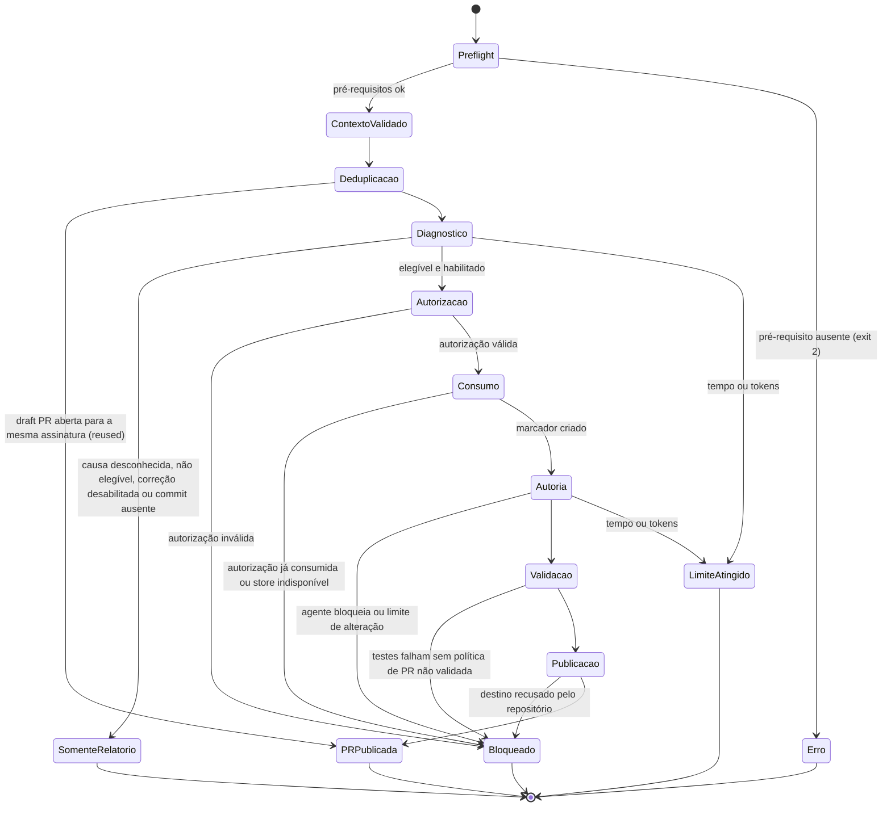

# Fase 1 — Modelo de Dados: pipeline-guard — Execução Não Assistida

**Spec**: [spec.md](./spec.md)

Esta feature reutiliza as entidades da spec principal (Configuração do Projeto, Incidente, Evidência, Diagnóstico, Decisão de Elegibilidade, Aprovação, Resultado de Remediação). Abaixo aparece só o que é novo ou muda. Os schemas propostos estão em [contracts/](./contracts/); seus casos positivos e negativos serão versionados com os testes previstos nas Tasks 1.1.1.2 a 1.1.1.5.

## Contexto da Falha (`incident_input_v1`, versão 1.1)

- **Campos novos**: `code_version` (`repository_url`, `branch`, `commit`), `host_run` (`host`, `run_reference`, `run_url`, `related_failed_steps[]`). A assinatura da falha passa a ocupar `correlation.signature`, campo que já existe.
- **Relações**: é a entrada do entrypoint não interativo; dá origem a exatamente uma Execução Não Assistida; a assinatura relaciona execuções repetidas da mesma falha.
- **Regras de validação**:
  - os blocos novos só são aceitos com `schema_version: "1.1"`; documentos `1.0` continuam válidos e não podem trazê-los (retrocompatibilidade);
  - no modo não interativo, `host_run` é obrigatório — sem ele a entrada é recusada (código de saída 2);
  - `code_version.commit` e `code_version.branch` são obrigatórios para corrigir; sem eles a execução diagnostica e para em "somente relatório" com `reason_code=MISSING_INPUT`, sem alterar nada (FR-004, FR-005);
  - `repository_url` e `run_url` não podem conter credenciais nem parâmetros assinados;
  - a etapa que falhou e as relacionadas vêm do host: a mais a montante é `failed_step`, as demais vão para `host_run.related_failed_steps` (FR-022).
- **Transições de estado**: `recebido` → `validado no modo não interativo` → `assinatura calculada` → (`deduplicado` | `diagnosticado`) — ou `recusado` (entrada inválida).

## Política de Execução Não Assistida (seção `unattended` da configuração)

- **Campos**: `remediation_enabled`, `service_identity`, `authorization_secret_ref`, `authorization_max_age_seconds` (padrão 900), `target_branch` (padrão nulo), `max_seconds` (padrão 3600), `max_model_tokens`.
- **Relações**: pertence à Configuração do Projeto; governa a emissão da Autorização por Política, o destino da draft PR e os limites da Execução Não Assistida.
- **Regras de validação**:
  - sem a seção, ou com `remediation_enabled: false`, a execução não assistida entrega só diagnóstico, elegibilidade e relatório (FR-008);
  - `remediation_enabled: true` exige `authorization_secret_ref` (referência `env:`, `${...}` ou `secret:`, nunca literal) e `max_model_tokens`;
  - `service_identity` é um rótulo não pessoal, nunca uma credencial;
  - como o arquivo é versionado, habilitar a correção não assistida passa por revisão de PR no projeto consumidor.
- **Transições de estado**: nenhuma; documento estático revalidado a cada execução.

## Autorização por Política (`approval_input_v1` com `channel_type=policy`)

- **Campos**: `incident_id`, `diagnosis_hash`, `decision=APPROVED`, `actor` (= `service_identity`), `decided_at`, `channel_type=policy`, `external_reference` (= `host_run.run_url` ou `run_reference`), `signature` (`hmac-sha256:`), `base_commit` (= `code_version.commit`). O schema `approval_input_v1` não muda; o perfil está em [contracts/approval_input_v1.policy_profile.schema.json](./contracts/approval_input_v1.policy_profile.schema.json).
- **Relações**: vinculada a um Diagnóstico (hash), a uma Decisão de Elegibilidade `ELIGIBLE_FOR_REMEDIATION` e a uma Execução Não Assistida; habilita um Resultado de Remediação.
- **Regras de validação**:
  - emitida somente pelo entrypoint não interativo, depois do gate de elegibilidade e com `remediation_enabled: true` (FR-009);
  - assinada com o segredo do host e autenticada pelo `approval_authenticator` antes do `approval_validator` — o mesmo caminho das aprovações orquestradas (Decisão 7 da spec principal);
  - validade máxima de `authorization_max_age_seconds` e uso único por execução: antes da primeira
    escrita, o hash da autorização assinada e a referência da execução do host são consumidos com
    `put` create-once no store persistente resolvido de `--authorization-state-dir`;
  - com a remediação habilitada, a ausência, inacessibilidade ou falta de semântica create-once no
    diretório de estado bloqueia a execução antes da criação do workspace;
  - `channel_type=local` é recusado no modo não interativo (FR-002, Decisão 8 da spec principal);
  - o segredo de assinatura nunca chega ao modelo, ao agente de autoria nem às ferramentas controladas pelo modelo (FR-014).
- **Transições de estado**: `emitida` → `autenticada` → `validada` → `consumida`; ou `recusada` (assinatura, vínculo ou validade inválidos).

## Execução Não Assistida (`unattended_run_result_v1`)

- **Campos**: `outcome`, `exit_code`, `reason_code`, `incident_id`, `failure_signature`, `service_identity`, `host_run`, `code_version`, `started_at`, `finished_at`, `duration_seconds`, `config_hash`, `decisions[]`, `diagnosis`, `eligibility`, `authorization`, `draft_pr`, `pushed_branch`, `remediation_result_ref`, `artifacts[]`, `limitations[]`, `summary`.
- **Relações**: consome um Contexto da Falha e a Política; agrega Diagnóstico, Decisão de Elegibilidade, Autorização por Política e Resultado de Remediação da mesma execução.
- **Regras de validação**:
  - pares fixos de desfecho e código de saída (ver Desfecho da Execução);
  - `DRAFT_PR_PUBLISHED` sempre exige `failure_signature` e `code_version`; com PR nova também exige diagnóstico, elegibilidade, autorização autenticada e `remediation_result_ref`;
  - "somente relatório" nunca traz autorização, PR ou branch publicada;
  - cada desfecho aceita somente seus `reason_code` documentados;
  - falha ou limite depois do push informa `pushed_branch` e interrompe novas operações externas;
  - `summary` e todos os artefatos retidos passam pelo mascaramento antes de serem escritos (FR-024);
  - cada artefato retido tem `sha256`.
- **Transições de estado**:

## Desfecho da Execução

| Desfecho | Código de saída | Quando | `reason_code` típicos |
|---|---|---|---|
| `DRAFT_PR_PUBLISHED` | 0 | Draft PR criada, ou reaproveitada para a mesma assinatura (`draft_pr.reused`) | — |
| `REPORT_ONLY` | 3 | Diagnóstico entregue sem correção | `NOT_ELIGIBLE`, `UNKNOWN_CAUSE`, `REMEDIATION_DISABLED`, `MISSING_INPUT` |
| `BLOCKED` | 4 | Um controle impediu a publicação | `AUTHORIZATION_INVALID`, `VALIDATION_FAILED`, `CHANGE_LIMIT_EXCEEDED`, `PR_TARGET_REFUSED`, `RECURSION_GUARD` |
| `LIMIT_REACHED` | 5 | Tempo, tokens ou chamadas de ferramenta esgotados; nenhuma nova operação é iniciada e, se o push já ocorreu, `pushed_branch` é informado | `TIME_LIMIT`, `TOKEN_LIMIT`, `TOOL_CALL_LIMIT` |
| `ERROR` | 1 | Falha operacional | `MODEL_UNAVAILABLE`, `CREDENTIAL_UNAVAILABLE`, `OPERATIONAL_FAILURE` |
| `ERROR` | 2 | Entrada, configuração ou pré-requisito inválido, antes de qualquer alteração | `INVALID_INPUT`, `PREREQUISITE_MISSING` |

Os códigos 0 a 3 mantêm o mesmo sentido do `diagnose_cli.py` (0 sucesso, 1 falha operacional, 2 entrada inválida, 3 parada controlada).

## Ponto de Decisão

- **Campos**: `id`, `resolution` (`INPUT` | `CONFIG` | `DOCUMENTED_DEFAULT` | `SAFE_STOP`), `value`.
- **Regras de validação**: decisões de segurança, escopo da alteração ou destino da publicação nunca usam `DOCUMENTED_DEFAULT` (FR-005).
- **Catálogo inicial** (o guia de execução não assistida publica a versão final):

| Ponto de decisão no fluxo interativo | Resolução no modo não interativo |
|---|---|
| Caminho da configuração e do incidente | `INPUT`: argumentos da invocação |
| Em que PR ou commit a falha ocorreu (entrevista) | `INPUT`: `code_version.commit`; ausente → `SAFE_STOP` (somente relatório) |
| Branch de destino da draft PR | `CONFIG` (`unattended.target_branch`) ou `INPUT` (`code_version.branch`); ausente → `SAFE_STOP` |
| Confirmação para corrigir (aprovação local) | `CONFIG` (`remediation_enabled`) + Autorização por Política |
| Seguir para a correção depois do diagnóstico | `DOCUMENTED_DEFAULT`: seguir somente com `ELIGIBLE_FOR_REMEDIATION` |
| Publicar PR com testes falhos ou ausentes | `CONFIG` (`remediation.allow_unvalidated_draft`, padrão `false`) |
| Nova tentativa quando a primeira publicação não surtiu efeito | `DOCUMENTED_DEFAULT`: reconsultar e reaproveitar a PR existente |
| Mais de uma correção plausível | `SAFE_STOP`: o agente de autoria bloqueia e o desfecho é `BLOCKED` |
| Descartar o workspace no fim | `DOCUMENTED_DEFAULT`: descartar depois de publicar ou bloquear |
| Sobrescrever configuração existente (setup) | Fora do modo não interativo; o setup continua interativo e é pré-requisito |

## Assinatura da Falha

- **Campos**: `sha256:` sobre a representação canônica da identidade do repositório, `pipeline_id`, `code_version.commit` e branch de destino resolvida. `failed_step` permanece evidência obrigatória, mas fica fora da assinatura para que falhas paralelas da mesma execução convirjam.
- **Relações**: gravada em `correlation.signature` e numa linha visível `Signature:` da descrição da draft PR, ao lado das linhas `ID:` e `Run:` que a spec principal já usa; também deriva uma branch de remediação determinística sob `repository.remediation_branch_prefix`.
- **Regras de validação**: somente depois do diagnóstico, da elegibilidade e da autorização por política, uma consulta somente leitura pode localizar uma draft PR aberta e evitar novo workspace, push e publicação. Antes de criar e depois de conflito de push ou criação, o publicador privado do Pipeline Guard reconcilia novamente a identidade completa da PR — repositório de origem, branch de origem determinística, branch de destino, assinatura, estado aberto e marcação de draft. Só uma correspondência completa produz `DRAFT_PR_PUBLISHED` com `reused=true` (FR-021, SC-008). Mudanças de repositório, commit ou destino geram assinaturas diferentes.
- **Transições de estado**: nenhuma; valor derivado.

## Identidade de Serviço

- **Finalidades**, cada uma com a menor permissão possível no host:
  1. **Leitura do pipeline**: ler a execução que falhou, seus logs e artefatos.
  2. **Escrita restrita no repositório**: push da branch de correção e criação da draft PR.
  3. **Uso do modelo**: chamar o endpoint Anthropic ou OpenAI-compatible selecionado.
  4. **Segredo de autorização**: assinar a Autorização por Política.
- **Regras de validação**: nenhuma identidade pessoal (FR-013); as credenciais de escrita e o segredo de autorização ficam fora do alcance do modelo e das ferramentas controladas por ele (FR-014); os guias por host listam as permissões mínimas de cada finalidade (FR-025).
